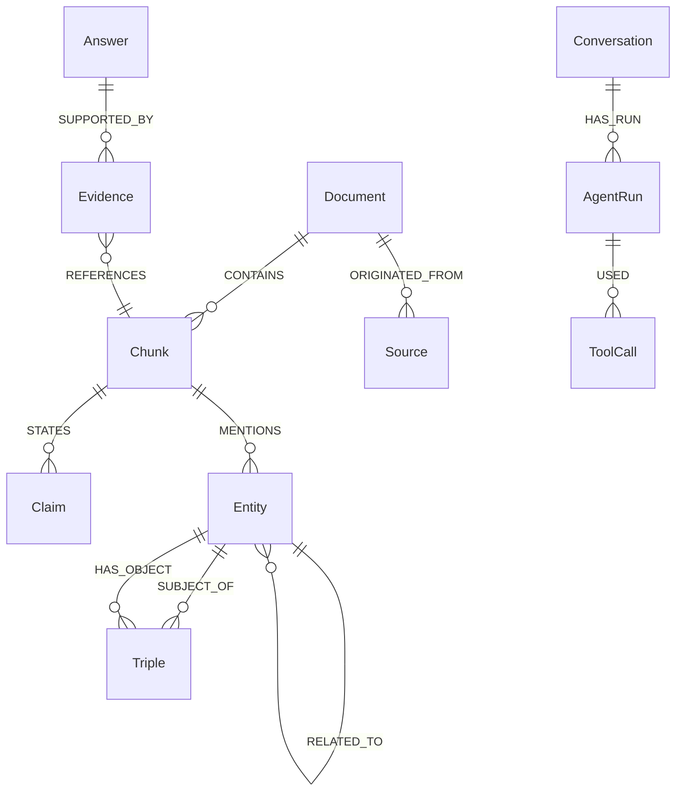
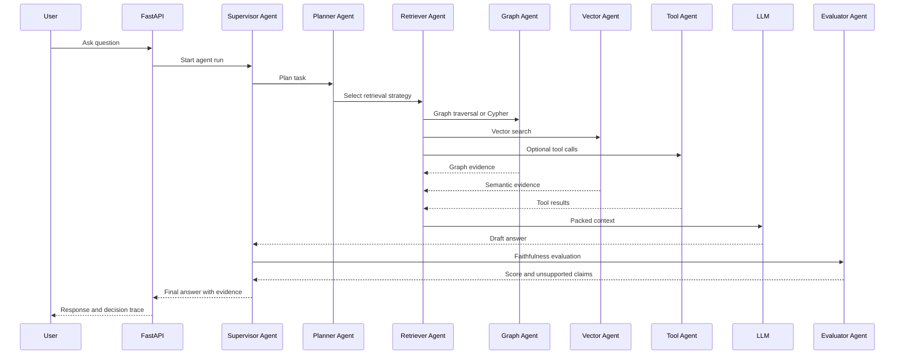
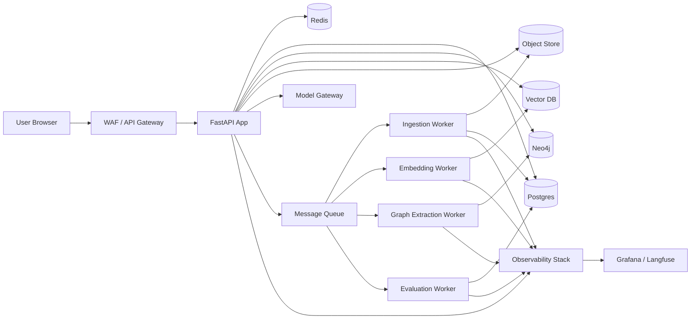

# Agentic GraphRAG Platform

A production-oriented **Agentic GraphRAG system** for multimodal document ingestion, hybrid retrieval, knowledge graph construction, vector search, multi-agent reasoning workflows, faithfulness evaluation, graph triples preview and graph visualisation.

This project is designed as a serious enterprise-style reference architecture rather than a simple notebook demo. It separates ingestion, retrieval, agent orchestration, evaluation, governance, observability and presentation into clear layers so the system can scale from local development to production deployment.

---

## 1. Executive Summary

The Agentic GraphRAG Platform combines:

- Multiple data sources
- Multimodal ingestion
- Knowledge graph extraction
- Vector database indexing
- Hybrid retrieval
- Multi-agent orchestration
- LLM-based answer generation
- Faithfulness evaluation
- Graph triples preview
- Graph visualisation
- Safe decision trace reporting
- Production observability and governance

The purpose of the platform is to allow users to ask natural language questions over complex enterprise knowledge while receiving answers that are grounded in source evidence, traceable back to documents, graph relationships and retrieved context.

The platform should not expose hidden chain-of-thought. Instead, it exposes a structured **decision trace** showing the retrieval strategy, selected tools, graph queries, evidence used, confidence scores, evaluator results and unsupported claims.

---

## 2. Core Problem Statement

Traditional Retrieval-Augmented Generation systems often rely only on vector search. This can be useful for semantic matching but weak for:

- Relationship-heavy questions
- Dependency analysis
- Source lineage
- Explainability
- Structured domain reasoning
- Multi-hop retrieval
- Auditability
- Evidence traceability
- Factual grounding

This project addresses those limitations by combining a **GraphRAG architecture** with **agentic orchestration**.

The graph layer captures entities, relationships, claims, triples and provenance. The vector layer captures semantic similarity. The agent layer decides how to use graph search, vector search, tools, memory and evaluation dynamically.

---

## 3. Target Outcomes

The project should deliver a system that can:

1. Ingest multiple types of enterprise data.
2. Extract entities, relationships, claims and triples.
3. Store structured knowledge in a graph database.
4. Store semantic embeddings in a vector database.
5. Retrieve evidence using graph, vector and keyword search.
6. Use a multi-agent workflow to plan, retrieve, query tools and synthesise answers.
7. Evaluate generated answers for faithfulness against retrieved context.
8. Show graph triples through fuzzy search.
9. Visualise graph relationships and subgraphs.
10. Preserve conversation context and history.
11. Provide a safe decision trace for auditability.
12. Support production observability, governance and deployment.

---

## 4. High-Level Architecture

```mermaid
flowchart TB

    subgraph DS[Multiple Data Sources]
        A1[PDFs, Word, PowerPoint]
        A2[Images, diagrams and scanned docs]
        A3[Audio and video transcripts]
        A4[SQL databases]
        A5[SharePoint, Confluence and Google Drive]
        A6[APIs and web pages]
        A7[Telemetry, logs and sensor data]
    end

    subgraph ING[Multimodal Ingestion Layer]
        B1[Connectors]
        B2[Document parsing]
        B3[OCR and layout extraction]
        B4[VLM image understanding]
        B5[Audio transcription]
        B6[Chunking and metadata enrichment]
        B7[PII and security classification]
    end

    subgraph EXT[Knowledge Extraction Layer]
        C1[Entity extraction]
        C2[Relationship extraction]
        C3[Claim extraction]
        C4[Table extraction]
        C5[Schema normalisation]
        C6[Triple generation]
        C7[Embedding generation]
    end

    subgraph STORE[Knowledge Stores]
        D1[(Graph DB)]
        D2[(Vector DB)]
        D3[(Object Store)]
        D4[(Metadata DB)]
        D5[(Conversation Memory)]
    end

    subgraph RET[Hybrid Retrieval Layer]
        E1[Vector similarity search]
        E2[Graph traversal]
        E3[Cypher generation]
        E4[Keyword search]
        E5[Reranking]
        E6[Context packing]
        E7[Source attribution]
    end

    subgraph AG[Multi-Agent Orchestration]
        F1[Supervisor Agent]
        F2[Planner Agent]
        F3[Retriever Agent]
        F4[Graph Query Agent]
        F5[Vector Search Agent]
        F6[Tool Agent]
        F7[Answer Synthesiser]
        F8[Evaluator Agent]
        F9[Human Escalation]
    end

    subgraph UI[Presentation Layer]
        I1[Chat UI]
        I2[Decision Trace Panel]
        I3[Evidence Viewer]
        I4[Graph Triples Preview]
        I5[Graph Visualisation]
        I6[Evaluation Dashboard]
    end

    DS --> ING
    ING --> EXT
    EXT --> D1
    EXT --> D2
    ING --> D3
    EXT --> D4
    D1 --> RET
    D2 --> RET
    D4 --> RET
    D5 --> AG
    RET --> AG
    AG --> UI
```



---

## 5. Architecture Principles

The system follows these principles:

- **Grounded answers first**: generated answers should be tied to retrieved evidence.
- **Hybrid retrieval over single retrieval**: graph, vector and keyword retrieval each solve different problems.
- **Explainability without hidden chain-of-thought**: expose decision trace, not raw model reasoning.
- **Separation of concerns**: ingestion, storage, retrieval, agents and evaluation are separate layers.
- **Production-readiness**: observability, audit, security and evaluation are built in from the beginning.
- **Open-source first**: default stack uses free and open-source tools where possible.
- **Extensible connectors**: new data sources should be added through connector interfaces.
- **Pluggable model providers**: LLMs and embedding models should be replaceable through a model gateway.
- **Governed tool use**: agents should use only approved tools with logged inputs and outputs.

---

## 6. Recommended Open-Source Stack

The project is designed around the best practical free and open-source components.

| Layer | Recommended Tools |
|---|---|
| Backend API | FastAPI, Uvicorn, Pydantic |
| Async workers | Celery, Redis |
| Graph database | Neo4j Community, Memgraph as an alternative |
| Vector database | Qdrant, pgvector as an alternative |
| Metadata database | Postgres |
| Object storage | MinIO |
| Local model serving | Ollama |
| Agent orchestration | LangGraph |
| Document parsing | Docling, Unstructured, PyMuPDF, pdfplumber |
| OCR and images | Tesseract, OpenCV, Pillow |
| Audio transcription | Whisper-compatible local models |
| Reranking and embeddings | sentence-transformers, FlagEmbedding |
| Evaluation | Ragas, DeepEval, custom evaluators |
| Observability | OpenTelemetry, Prometheus, Grafana, Langfuse |
| Frontend | React, TypeScript, Vite |
| Graph UI | Cytoscape.js, React Flow, Sigma.js |
| Testing | pytest, pytest-asyncio |
| Packaging | pyproject.toml, Docker, Docker Compose |

Commercial APIs such as OpenAI, Anthropic, Azure OpenAI, Cohere, Pinecone or managed Neo4j can be added later through provider interfaces, but the initial stack should work locally with open-source tools.

---

## 7. Data Sources

The platform should support a wide range of data sources.

| Source Type | Examples | Ingestion Method |
|---|---|---|
| Documents | PDF, DOCX, PPTX, XLSX | Docling, Unstructured, PyMuPDF, python-docx, python-pptx |
| Images | Diagrams, schematics, scanned forms | OCR, VLM extraction, image captioning |
| Audio | Meetings, calls, interviews | Whisper transcription |
| Video | Training videos, inspections | Frame extraction, transcription, image understanding |
| Databases | Postgres, SQL Server, MySQL | SQLAlchemy connectors |
| APIs | Jira, ServiceNow, internal APIs | REST clients |
| Collaboration tools | SharePoint, Confluence, Google Drive | Source connectors |
| Web pages | Public or internal sites | Crawler and sitemap loaders |
| Logs and telemetry | Application logs, sensor data | Batch or streaming ingestion |

---

## 8. Ingestion Pipeline

The ingestion plane is asynchronous and worker-driven.

```text
Source connector
→ document parsing
→ OCR / VLM extraction
→ chunking
→ metadata enrichment
→ entity extraction
→ relationship extraction
→ claim extraction
→ triple generation
→ embedding generation
→ graph storage
→ vector storage
→ indexing
→ quality checks
```

Key responsibilities:

- Persist original files to object storage.
- Extract clean text, tables, images and layout metadata.
- Create chunks suitable for retrieval.
- Preserve page numbers, section headings and source metadata.
- Extract entities and relationships.
- Generate subject-predicate-object triples.
- Generate embeddings for semantic search.
- Write graph data to Neo4j.
- Write vectors to Qdrant or pgvector.
- Store metadata and ingestion job status in Postgres.
- Log every step for audit and debugging.

---

## 9. Knowledge Extraction

The extraction layer converts raw content into structured knowledge.

Expected extractors:

- `EntityExtractor`
- `RelationshipExtractor`
- `ClaimExtractor`
- `TripleExtractor`
- `TableExtractor`
- `SchemaMapper`
- `DeduplicationService`
- `ConfidenceScorer`

Example triple:

```json
{
  "subject": "GraphRAG ingestion pipeline",
  "predicate": "generates",
  "object": "entity relationship triples",
  "source_document": "architecture_overview.pdf",
  "chunk_id": "chunk_0182",
  "confidence": 0.87,
  "page": 14,
  "extraction_model": "local-llm-or-provider",
  "created_at": "2026-05-22T09:00:00Z"
}
```

---

## 10. Graph Data Model

The graph should be more expressive than generic `Entity` and `RELATES_TO` nodes.

Suggested node labels:

```text
Document
Chunk
Entity
Claim
Triple
Person
Organisation
System
Component
Requirement
Risk
Control
Process
Dataset
Model
Tool
Source
Conversation
AgentRun
ToolCall
Evidence
EvaluationResult
```

Suggested relationship types:

```text
CONTAINS
MENTIONS
SUPPORTS
CONTRADICTS
DEPENDS_ON
PART_OF
IMPLEMENTS
USES
OWNS
AUTHORISED_BY
DERIVED_FROM
HAS_SOURCE
HAS_CONFIDENCE
EVALUATED_BY
```

Core graph model:



---

## 11. Storage Architecture

### Graph Database

The graph database stores:

- Entities
- Relationships
- Claims
- Triples
- Document lineage
- Source provenance
- Evidence links
- Agent tool traces

Recommended default: **Neo4j Community**.

Alternative: **Memgraph**.

### Vector Database

The vector database stores embeddings for:

- Text chunks
- Table summaries
- Image captions
- Extracted claims
- Possibly graph neighbourhood summaries

Recommended default: **Qdrant**.

Alternative: **pgvector**.

### Metadata Database

Postgres stores:

- Documents
- Document versions
- Chunks
- Ingestion jobs
- Source permissions
- Evaluation runs
- Agent sessions
- Tool calls
- Audit logs

### Object Store

MinIO stores:

- Raw files
- Parsed markdown
- Page images
- OCR output
- Tables
- Transcripts
- Graph exports
- Evaluation reports

### Conversation Memory

Redis and Postgres store:

- Active sessions
- Conversation summaries
- Agent state
- Short-term history
- Long-term memory records where allowed

---

## 12. Hybrid Retrieval

The retrieval system combines multiple methods.

| Retrieval Mode | Best For |
|---|---|
| Vector search | Semantic similarity |
| Graph traversal | Relationships, dependencies, lineage and multi-hop reasoning |
| Keyword / BM25 search | Exact terms, part numbers, named entities and policy references |
| Cypher retrieval | Structured graph questions |
| Reranking | Improving final context quality |
| Fusion | Combining graph, vector and keyword results |

Retrieval flow:

```text
User question
→ query rewriting
→ intent classification
→ retrieval strategy selection
→ graph retrieval
→ vector retrieval
→ keyword retrieval
→ reranking
→ context packing
→ citation generation
→ answer synthesis
```

---

## 13. Multi-Agent Mode

The system supports multi-agent orchestration for dynamic workflows.

| Agent | Responsibility |
|---|---|
| Supervisor Agent | Owns the conversation and routes work |
| Planner Agent | Breaks the query into steps |
| Retriever Agent | Decides graph, vector, keyword or hybrid retrieval |
| Graph Agent | Generates safe graph queries or calls graph tools |
| Vector Agent | Handles semantic retrieval and reranking |
| Tool Agent | Calls approved APIs, SQL, web tools or internal services |
| Synthesiser Agent | Produces the final grounded answer |
| Evaluator Agent | Checks faithfulness, relevance and unsupported claims |
| Memory Agent | Reads and writes session memory |
| Governance Agent | Applies permissions, redaction and safety checks |

Agent flow:



---

## 14. Decision Trace

The system should show a structured decision trace, not hidden chain-of-thought.

Example:

```json
{
  "agent_run_id": "run_001",
  "user_intent": "technical_architecture_question",
  "retrieval_strategy": "hybrid_graph_vector",
  "tools_used": [
    {
      "tool": "vector_search",
      "reason": "Find semantically relevant document chunks",
      "top_k": 8
    },
    {
      "tool": "graph_traversal",
      "reason": "Find relationships between systems, data sources and models",
      "cypher_template": "entity_neighbourhood"
    }
  ],
  "decision_points": [
    {
      "step": "route_query",
      "decision": "Use hybrid retrieval",
      "why": "The question asks for architecture, dependencies and implementation detail"
    },
    {
      "step": "answer_check",
      "decision": "Run faithfulness evaluation",
      "why": "The answer contains factual claims derived from retrieved documents"
    }
  ],
  "faithfulness_score": 0.94,
  "unsupported_claims": []
}
```

This supports explainability and audit without exposing private model reasoning.

---

## 15. Faithfulness Evaluation

Faithfulness evaluation checks whether statements in generated answers are directly supported by the retrieved source context.

Recommended flow:

```text
Generated answer
→ split into atomic claims
→ compare each claim against retrieved chunks
→ mark supported / partially supported / unsupported
→ calculate faithfulness score
→ repair, regenerate or refuse if below threshold
```

Suggested thresholds:

| Score | Action |
|---|---|
| 0.90 to 1.00 | Allow answer |
| 0.75 to 0.89 | Allow with caution |
| 0.50 to 0.74 | Regenerate with stricter context |
| Below 0.50 | Refuse or request more evidence |

Example output:

```json
{
  "answer_id": "ans_001",
  "faithfulness_score": 0.91,
  "claims": [
    {
      "claim": "The system uses graph and vector retrieval.",
      "status": "supported",
      "supporting_chunks": ["chunk_014", "chunk_018"]
    },
    {
      "claim": "The system guarantees perfect factual accuracy.",
      "status": "unsupported",
      "supporting_chunks": []
    }
  ],
  "recommended_action": "remove_unsupported_claims"
}
```

---

## 16. Graph Triples Preview

The triples preview allows users to inspect indexed subject-predicate-object triples.

Features:

- Fuzzy search over triples
- Filter by confidence score
- Filter by document
- Filter by entity
- Open source chunk
- Open graph visualisation
- Export selected triples

Example API:

```text
GET /api/triples/search?q=graph%20retrieval
GET /api/triples/{triple_id}
```

Useful implementation options:

- Postgres trigram search
- Neo4j full-text indexes
- RapidFuzz
- OpenSearch as an optional later upgrade

---

## 17. Graph Presentation

The graph presentation layer allows users to inspect the knowledge graph visually.

Features:

- Search entity
- Expand neighbours
- Filter by relationship type
- Filter by source document
- Filter by confidence score
- Show source chunk
- Show page reference
- Show extracted triples
- Show path between entities
- Export subgraph as JSON, CSV or GraphML

Example API:

```text
GET /api/graph/entities/search
GET /api/graph/entities/{id}/neighbours
GET /api/graph/path?source=A&target=B
GET /api/graph/subgraph
GET /api/graph/schema
```

Recommended frontend libraries:

- Cytoscape.js
- React Flow
- Sigma.js
- D3.js

---

## 18. UI Design

The production UI should include:

1. **Chat Panel**  
   User asks questions and receives grounded answers.

2. **Evidence Panel**  
   Shows retrieved chunks, source documents, pages and confidence.

3. **Decision Trace Panel**  
   Shows selected retrieval strategy, tools used, graph queries and evaluator results.

4. **Graph Triples Preview**  
   Allows fuzzy search over extracted triples.

5. **Graph Visualisation**  
   Shows entities, relationships, sources and traversal paths.

6. **Evaluation Dashboard**  
   Displays faithfulness, context precision, context recall, answer relevance and unsupported claims.

---

## 19. API Groups

Primary API groups:

```text
POST   /api/chat
GET    /api/chat/{session_id}/history
GET    /api/chat/runs/{run_id}/trace

POST   /api/ingestion/jobs
POST   /api/ingestion/files
GET    /api/ingestion/jobs/{job_id}

GET    /api/documents
GET    /api/documents/{document_id}
GET    /api/documents/{document_id}/chunks

GET    /api/graph/entities/search
GET    /api/graph/entities/{entity_id}/neighbours
GET    /api/graph/path
GET    /api/graph/subgraph
GET    /api/graph/schema

GET    /api/triples/search
GET    /api/triples/{triple_id}

POST   /api/evaluation/faithfulness
POST   /api/evaluation/runs
GET    /api/evaluation/runs/{run_id}

GET    /api/admin/status
GET    /api/admin/config
GET    /api/admin/metrics
```

---

## 20. Project Structure

```text
agentic-graphrag/
│
├── README.md
├── pyproject.toml
├── docker-compose.yml
├── Dockerfile
├── .env.example
├── Makefile
│
├── apps/
│   ├── api/
│   │   ├── main.py
│   │   ├── dependencies.py
│   │   ├── middleware.py
│   │   └── routers/
│   │       ├── chat.py
│   │       ├── ingestion.py
│   │       ├── graph.py
│   │       ├── triples.py
│   │       ├── evaluation.py
│   │       ├── documents.py
│   │       └── admin.py
│   │
│   ├── worker/
│   │   ├── celery_app.py
│   │   ├── ingestion_tasks.py
│   │   ├── embedding_tasks.py
│   │   ├── graph_tasks.py
│   │   └── evaluation_tasks.py
│   │
│   └── frontend/
│       ├── package.json
│       ├── index.html
│       ├── tsconfig.json
│       ├── vite.config.ts
│       └── src/
│           ├── pages/
│           └── components/
│
├── src/
│   └── graphrag_system/
│       ├── config/
│       ├── connectors/
│       ├── ingestion/
│       ├── extraction/
│       ├── storage/
│       │   ├── graph/
│       │   ├── vector/
│       │   ├── object_store/
│       │   └── relational/
│       ├── retrieval/
│       ├── agents/
│       ├── tools/
│       ├── llm/
│       ├── evaluation/
│       ├── graph_presentation/
│       ├── memory/
│       ├── governance/
│       ├── observability/
│       └── utils/
│
├── tests/
│   ├── unit/
│   ├── integration/
│   ├── evals/
│   └── fixtures/
│
├── notebooks/
├── infra/
└── docs/
```

---

## 21. Codebase Responsibilities

### `apps/api`

FastAPI application layer.

Responsible for:

- HTTP routing
- request validation
- response models
- middleware
- dependency injection
- health and readiness endpoints

Should not contain heavy business logic.

### `apps/worker`

Celery worker layer.

Responsible for:

- ingestion jobs
- embedding jobs
- graph extraction jobs
- indexing jobs
- evaluation jobs

### `apps/frontend`

React frontend.

Responsible for:

- chat interface
- evidence viewer
- graph visualisation
- triples preview
- decision trace panel
- evaluation dashboard

### `src/graphrag_system`

Core domain package.

Responsible for:

- connectors
- ingestion
- extraction
- storage
- retrieval
- agent orchestration
- tools
- LLM gateway
- evaluation
- governance
- observability

### `tests`

Testing suite.

Responsible for:

- unit tests
- integration tests
- evaluation regression tests
- fixtures

### `infra`

Deployment and operations.

Responsible for:

- Docker assets
- Kubernetes manifests
- Terraform modules
- Helm charts
- Grafana dashboards

### `docs`

Technical documentation.

Responsible for:

- architecture
- data model
- API contracts
- deployment notes
- evaluation guidance
- security guidance

---

## 22. Production Deployment View



---

## 23. Local Development

### Prerequisites

Recommended:

- Python 3.11+
- Docker
- Docker Compose
- Node.js 20+
- Make
- Git

### Environment

Copy the example environment file:

```bash
cp .env.example .env
```

### Start local services

```bash
docker compose up -d
```

### Install backend dependencies

```bash
pip install -e ".[dev]"
```

### Run the API

```bash
uvicorn apps.api.main:app --reload --host 0.0.0.0 --port 8000
```

### Run worker

```bash
celery -A apps.worker.celery_app worker --loglevel=INFO
```

### Run frontend

```bash
cd apps/frontend
npm install
npm run dev
```

---

## 24. Testing

Run all tests:

```bash
pytest
```

Run unit tests:

```bash
pytest tests/unit
```

Run integration tests:

```bash
pytest tests/integration
```

Run evaluation tests:

```bash
pytest tests/evals
```

---

## 25. Governance and Security

Production implementation should include:

- Authentication
- Role-based access control
- Source-level permissions
- Document-level permissions
- Conversation audit logs
- Tool-call audit logs
- Prompt injection detection
- PII detection
- PII redaction
- Secrets management
- Rate limiting
- Tenant isolation where required
- Safe execution boundaries for tools

Important: the system should not expose hidden chain-of-thought. It should expose structured decision traces.

---

## 26. Observability

The system should capture:

- Request latency
- Agent run latency
- Tool-call latency
- Retrieval latency
- Graph query latency
- Vector search latency
- Ingestion job duration
- Evaluation scores
- Token usage
- Model costs where applicable
- Error rates
- Unsupported claim counts
- Faithfulness score trends

Recommended tooling:

- OpenTelemetry
- Prometheus
- Grafana
- Langfuse
- structured logs
- Sentry or equivalent error reporting

---

## 27. Implementation Roadmap

### Phase 1: Foundation

- FastAPI backend
- Postgres metadata store
- Neo4j graph store
- Qdrant vector store
- MinIO object storage
- Redis and Celery
- Basic frontend shell
- Health checks

### Phase 2: Ingestion

- Source connectors
- Document parsing
- OCR support
- Chunking
- Metadata enrichment
- Object storage persistence
- Ingestion job tracking

### Phase 3: GraphRAG

- Entity extraction
- Relationship extraction
- Claim extraction
- Triple extraction
- Graph schema
- Graph writer
- Graph reader
- Triples preview

### Phase 4: Retrieval

- Vector retrieval
- Graph retrieval
- Keyword retrieval
- Reranking
- Context packing
- Citation generation

### Phase 5: Agentic Mode

- Supervisor agent
- Planner agent
- Retriever agent
- Graph agent
- Vector agent
- Tool agent
- Synthesiser agent
- Memory agent
- Decision trace

### Phase 6: Evaluation

- Faithfulness evaluation
- Context precision
- Context recall
- Answer relevance
- Regression test sets
- Evaluation dashboard

### Phase 7: Production Hardening

- RBAC
- Audit logging
- Redaction
- Observability
- CI/CD
- Kubernetes deployment
- Load testing
- Backup and restore
- Security reviews

---

## 28. Key Risks and Mitigations

| Risk | Mitigation |
|---|---|
| Hallucinated answers | Faithfulness evaluation, citations and unsupported claim detection |
| Poor retrieval quality | Hybrid retrieval, reranking and retrieval evaluation |
| Graph extraction noise | confidence scoring, schema validation and human review |
| Prompt injection | source sanitisation, policy filters and tool restrictions |
| Data leakage | RBAC, document permissions and redaction |
| Cost growth | local models, caching, token budgets and cost tracking |
| Slow ingestion | async workers, batching and queue monitoring |
| Tool misuse | approved tool registry and audit logs |
| Hidden reasoning exposure | decision trace instead of chain-of-thought |

---

## 29. Definition of Done

A production-ready version should meet these conditions:

- Multiple data sources can be ingested.
- Documents are parsed, chunked and stored.
- Entities, relationships, claims and triples are extracted.
- Graph and vector stores are populated.
- Users can ask questions through the chat UI.
- Retrieval uses graph and vector evidence.
- Answers include source-backed evidence.
- Faithfulness evaluation runs before or after answer generation.
- Decision trace is visible.
- Graph triples can be searched.
- Graph relationships can be visualised.
- Agent runs are observable.
- Security, audit and permissions are enforced.
- Tests and evaluation suites run in CI.

---

## 30. Summary

This project implements an **Agentic Hybrid GraphRAG platform**.

It combines:

```text
Multimodal ingestion
+ structured knowledge graph
+ vector search
+ graph traversal
+ multi-agent orchestration
+ evidence-backed answer synthesis
+ faithfulness evaluation
+ explainable decision trace
+ graph and triples visualisation
```

The end goal is a production-grade system that can reason over enterprise knowledge, provide grounded answers, support auditability and help users inspect the underlying graph of extracted knowledge.
